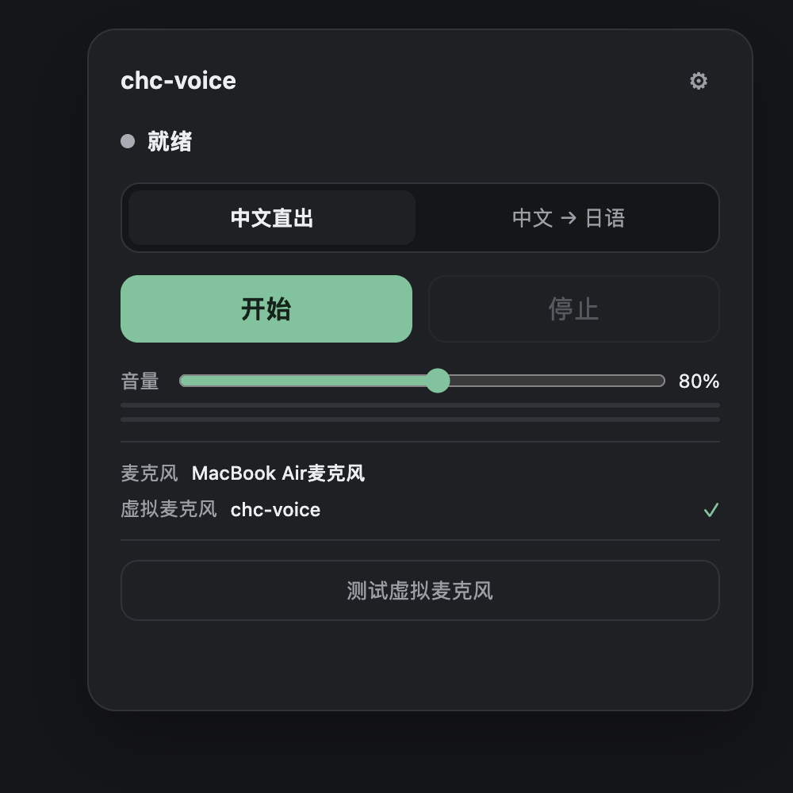

# chc-voice

<p align="center"></p>

macOS 本地语音跟读器：把真实麦克风里的中文，经百炼流式 ASR 识别后，用 Fish Audio 指定音色念出来，写入名为 **chc-voice** 的虚拟麦克风，供微信、游戏、Zoom、Discord 等软件当作麦克风使用。

```text
真实麦克风 → 百炼流式 ASR → 稳定前缀
                              ├─ 模式 A：中文 Fish 音色 → chc-voice
                              └─ 模式 B：LLM 翻译成日语 → 日语 Fish 音色 → chc-voice
```

## 当前状态（2026-10-29，本机实测）

| 项目 | 状态 |
|---|---|
| BlackHole 2ch | 已安装，Core Audio 可见 |
| Aggregate Device `chc-voice` | 已创建，2 in / 2 out |
| P0-A 回环 | 通过。向 BlackHole 写 440Hz，从 `chc-voice` 录回 RMS≈3883、峰值 8191 |
| 模式 A 端到端 | 通过。真实麦克风说话 → 识别 → 嘉岚 3.0 中文音色 → 虚拟麦克风 |
| 模式 B 端到端 | 通过。中文识别 → DeepSeek 翻译 → 拉姆日语 Fish 音色 |
| 停止静音 | 通过。停止后 `chc-voice` 录音 RMS=0 |
| UI | 本地 Web 面板 + Electron 壳 |
| 测试 | `pytest` 32 项通过 |
| 默认音色 | 中文：嘉岚3.0；日语：拉姆（Ramlethal） |
| 日语语气 | 默认口语（タメ口），可切换普通体/礼貌/商务敬语 |
| Key | 已从现有开发环境导入 macOS Keychain，界面只显示后四位 |

模式 B 第一段音频从提交到出声约 **1.1 秒**（翻译约 0.6 秒 + 预热的 Fish 约 0.5 秒）；模式 A 在预热命中时约 **0.5 秒**，刚点开始就说话、预连接尚未完成时约 **1.0 秒**。这是本机实测，不是承诺值，详见 [docs/latency.md](docs/latency.md)。

## 它不做什么

- 不做角色聊天、好感度、长期记忆、唤醒词、主动搭话；
- 不修改 `语音尝试/eidolon-src` 和 `eidolon-study`；
- 不部署服务器，不做 WebRTC、反向 SSH、移动端；
- MVP 不写自定义 AudioServerPlugIn，只使用 BlackHole + Aggregate Device。

## 快速开始

### 1. 安装 BlackHole 2ch

```bash
brew install --cask blackhole-2ch
# 或者使用仓库脚本（会显示管理员授权）：
scripts/install_blackhole.sh
```

安装后如果设备没有立刻出现：

```bash
sudo killall coreaudiod
```

还是不行就注销并重新登录。不要静默安装系统驱动；脚本会明确要求管理员权限。

### 2. 安装依赖

```bash
scripts/setup.sh
```

它会创建 `.venv`、安装 Python 包、安装 Electron 依赖。要求 Python 3.12+、Node.js 20+。

### 3. 配置三个 key

只写入 macOS Keychain，不写项目文件，不进前端 localStorage：

```bash
.venv/bin/chc-voice key set asr
.venv/bin/chc-voice key set tts
.venv/bin/chc-voice key set llm
```

也可以从开发用 `.env` 导入（仅作为开发回退）：

```bash
.venv/bin/chc-voice key import-env /path/to/.env
```

查看掩码状态：

```bash
.venv/bin/chc-voice key status
```

### 4. 创建 chc-voice Aggregate Device

```bash
.venv/bin/chc-voice aggregate create
```

或者启动 UI 后点“创建虚拟麦克风”。创建 Aggregate Device 不需要管理员权限。

### 5. 启动

浏览器面板：

```bash
.venv/bin/chc-voice serve --port 8791 --open
```

Electron 桌面窗口：

```bash
cd app && npm start
```

Electron 会自己选一个空闲的本机端口启动后端，再打开窗口；关掉窗口会停止后端。

> 本机 8791 端口可能被其他程序占用。换端口：`--port 8899`，或 `PORT=8899 scripts/run.sh`。

### 6. 微信 / 游戏 / Zoom / Discord

- 微信：设置 → 音频 → 麦克风 → `chc-voice`
- 游戏：音频设置 → 麦克风 → `chc-voice`
- Zoom/Discord：麦克风选择 `chc-voice`
- 使用系统默认输入的程序：把 macOS 输入设备设为 `chc-voice`

如果某个软件不显示 Aggregate Device，回退选择 `BlackHole 2ch`；两者收到的是同一路音频。

## 主界面

- 状态、当前模式（中文直出 / 中文 → 日语）
- 开始 / 停止
- 总音量（写入虚拟麦克风的音量，0–150%）
- 输入麦克风、虚拟麦克风状态
- 测试虚拟麦克风（写入 1.2 秒测试音）
- 紧急静音（清空缓冲并停止）
- 齿轮打开设置：API、音色（含日语语气）、音频、高级；高级默认折叠

测试按钮不会在对话框里回显 key；失败只显示服务名和状态码。

> UI 说明：本版 UI 由后端直接提供（原生 JS/CSS，无构建步骤），Electron 只负责启动后端和窗口。P0 阶段没有引入 React/Vite，避免在虚拟麦克风验证前增加构建链；功能不受影响。

## 两种模式

### 模式 A：`zh_direct`

```text
中文麦克风 → 百炼流式 ASR → 稳定前缀 → 中文 Fish 音色 → chc-voice
```

不调用 LLM。

### 模式 B：`zh_to_ja`

```text
中文麦克风 → 百炼流式 ASR → 稳定前缀 → Chat LLM 中文→日语 → 日语 Fish 音色 → chc-voice
```

只把 LLM 当翻译器，不注入角色人设、不保存翻译历史。翻译失败会报错并写静音，不会播放半截乱码。

### 日语语气

设置 → 音色 → 日语语气：

- **口语（タメ口）**：默认，朋友间自然说话，不用です・ます；
- **自然普通体**：常体，必要时少量です・ます；
- **礼貌（です・ます）**：普通礼貌体，不堆敬语；
- **商务敬语**：尊敬語・謙譲語，适合正式场合。

只影响模式 B 的翻译风格，不加角色设定；保存后下一段翻译生效。配置文件位置：

```toml
[translate]
tone = "casual"
```

运行中切换模式会立即停止当前 TTS、清空音频队列、清空虚拟麦克风缓冲，再以新模式继续；已经说出的内容不会撤回，也不会在同一条音频里混用中日语。

## 设置与密钥

运行配置在：

```text
~/Library/Application Support/chc-voice/
├── relay.toml       # 音频、模式、提交参数、网络
├── voices.toml      # Fish 模型与中/日 voice_id
├── metrics.jsonl    # 延迟与错误；不含文本内容
├── fish_voices.json # 音色列表缓存
└── logs/
```

Key 只在 Keychain：

```text
chc-voice.dashscope   DASHSCOPE_API_KEY
chc-voice.fish        FISH_AUDIO_API_KEY
chc-voice.llm         CHAT_LLM_API_KEY
```

- UI 只显示“已配置 ····后四位”；
- 不把 key 写进 TOML、日志、metrics、崩溃报告；
- `.env` 只作为开发回退，项目默认不读取明文 key；
- 删除 key 需要确认。

### Fish Audio 网络代理

Fish Audio 在当前网络需要代理。配置项：

```toml
[network]
fish_proxy = "http://127.0.0.1:7892"
```

留空时会自动读取 macOS 系统代理（`scutil --proxy`）。本地 UI 和 127.0.0.1 不经过代理。百炼和 DeepSeek 直连可用时不强制走代理。

## 延迟（本机实测）

| 路径 | 实测首段音频（从提交算起） | 说明 |
|---|---:|---|
| 模式 A，Fish 已预热 | ≈ 470 ms | 中文直出 |
| 模式 A，冷连接 | ≈ 1100 ms | 每次新建 Fish WebSocket |
| 模式 B，翻译 + 预热 | ≈ 1100 ms | 翻译约 590 ms |
| 停止 → 虚拟麦克风静音 | < 100 ms | 清空缓冲后持续写零 |

为了准确率，本版本默认**不在无标点的停顿处切句**（`pause_flush_ms = 0`），只在标点、ASR final、或达到最大长度时提交。代价是长句要等 final，但不会把“开会”切成“开”+“会”再翻译。若更在意延迟，可在 `relay.toml` 里把 `pause_flush_ms` 设为 300–600，或把 `stable_ms` / `min_chars` 调低。

## 故障排查

### 设备列表里没有 chc-voice

```bash
.venv/bin/chc-voice devices
.venv/bin/chc-voice aggregate create
```

- `BlackHole 2ch` 不在：重装 BlackHole，`sudo killall coreaudiod`，仍不行就注销。
- `BlackHole 2ch` 在，`chc-voice` 不在：点 UI 的“创建虚拟麦克风”，或运行 `aggregate create`。
- 目标软件不显示 Aggregate Device：直接选 `BlackHole 2ch`。

### 录不到声音 / 录音全是 0

- 系统设置 → 隐私与安全性 → 麦克风：允许终端 / DeepSeek Harness；
- 运行 `scripts/p0_loopback.py`，它会写入测试音并录回，失败会说明是权限还是路由问题；
- 确认没有把输入设备设成 `chc-voice` 本身（会自激）。

### Fish 401 / 402 / 403

- 401：key 无效或过期；
- 402：额度不足；
- 403：地区/权限限制；
- 先确认代理可用：`curl -x http://127.0.0.1:7892 https://api.fish.audio/`。

### 百炼 ASR 启动失败

确认 key 已开通 `qwen-audio-3.1-asr-flash-streaming`。本机默认北京地域，失败会自动试新加坡。

### 监听啸叫

监听默认关闭。打开时建议戴耳机，外放会让真实麦克风再次拾音形成反馈。紧急停止按钮会清空缓冲并静音。

## 开发与测试

```bash
cd backend
../.venv/bin/pytest -q
```

P0 脚本：

```bash
.venv/bin/python scripts/check_audio_devices.py
.venv/bin/python scripts/p0_loopback.py
.venv/bin/chc-voice tone --seconds 1.5
```

无 UI 直接跑：

```bash
.venv/bin/chc-voice listen --mode zh_direct
```

## 目录

```text
chc-voice/
├── backend/
│   ├── src/chc_voice/
│   │   ├── audio/       采集、重采样、虚拟麦克风、监听、限幅、CoreAudio
│   │   ├── asr/         百炼流式 ASR
│   │   ├── text/        稳定前缀、分句
│   │   ├── translate/   中文→日语
│   │   ├── tts/         Fish 流式/HTTP、音色列表
│   │   ├── relay/       模式、队列、取消、流水线
│   │   ├── server.py    本地 REST + WebSocket + 静态 UI
│   │   ├── settings_store.py  Keychain
│   │   └── config.py
│   └── tests/
├── app/                 Electron 壳（UI 由后端提供）
├── config/              relay.toml / voices.toml 模板
├── scripts/             安装、P0 检查、启动
├── docs/
└── artifacts/           测试录音（gitignore）
```

## 已知限制

- 不能保证所有软件都识别 Aggregate Device；
- 微信/游戏可能启用 AEC，改变声音；
- Fish 中文音色需要单独配置；当前默认中文音色是“嘉岚3.0”，日语是拉姆；
- 模式 B 依赖 LLM，延迟和翻译质量会波动；
- 外放监听会形成反馈；
- 虚拟设备时钟/underrun 由 macOS 和 BlackHole 行为决定；
- 应用未签名，打包分发时 Keychain 可能重新授权；
- 本项目只面向 macOS，不提供 Windows/Linux/服务器版本。
